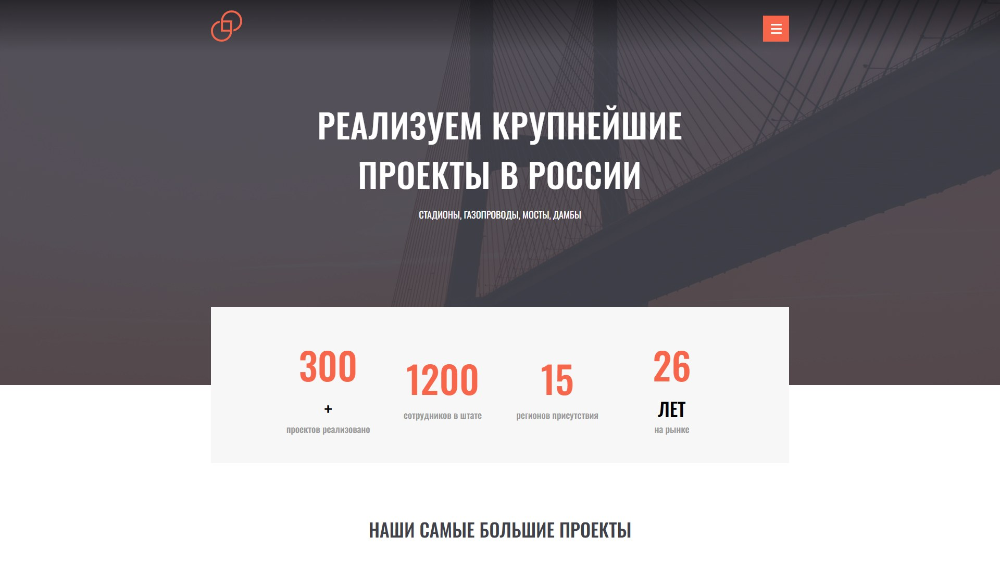

# 🏗️ Construction Company — лендинг строительной компании

Адаптивный одностраничный сайт строительной компании, свёрстанный с нуля по макету Figma. Десять содержательных блоков: от первого экрана с оффером до формы заявки и контактов. Pixel Perfect, кроссбраузерность, интерактив на чистом JavaScript без библиотек.

[>>> Открыть сайт <<<](https://pavelreb.github.io/Construction_Company/)



## ✨ Что внутри

- 🖥️ **Первый экран** с оффером и бургер-меню на весь экран
- 📊 **Метрика** — ключевые цифры компании
- 🏢 **Крупнейшие проекты** — карточки реализованных объектов
- 🛠️ **Услуги** — блок «Чем мы занимаемся»
- 🖼️ **Портфолио** — галерея выполненных работ
- ❓ **Ответы на вопросы** — аккордеон на чистом JS
- 🤝 **Партнёры** — логотипы компаний
- 💬 **Отзывы** клиентов
- 📩 **Форма заявки** и блок контактов с картой

## 🛠️ Технологии

| Технология | Применение |
|------------|-----------|
| **HTML5** | Семантическая разметка |
| **CSS3 (Flexbox / Grid)** | Сетки и раскладка блоков |
| **Media Queries** | Адаптив под десктоп, планшет и мобильные |
| **JavaScript (ES6)** | Бургер-меню и FAQ-аккордеон, без библиотек |
| **Figma + Pixel Perfect** | Вёрстка в точном соответствии с макетом |

## 🚀 Запуск

Сборка не требуется — достаточно открыть `index.html` в браузере или развернуть на любом статическом хостинге (GitHub Pages, Netlify, Vercel).

## 📁 Структура

```
Construction_Company/
├── index.html      # Разметка страницы
├── css/
│   ├── main.css    # Основные стили
│   ├── media.css   # Адаптив
│   ├── fonts.css   # Шрифты
│   └── reset.css   # Сброс стилей
├── js/
│   └── main.js     # Меню и аккордеон
├── img/            # Изображения и SVG
└── sourсe/         # Макет Figma, Pixel Perfect-референс
```

## 📎 Материалы проекта

- Макет Figma: [Перейти](https://www.figma.com/file/gOAqcgDUuVqZWRyWDgdMDr/Site)
- Серия видеоуроков, по которой велась вёрстка: [Смотреть](https://www.youtube.com/playlist?list=PLuY6eeDuleINcGnhxCG6U0kzja1Wh7fcd)
